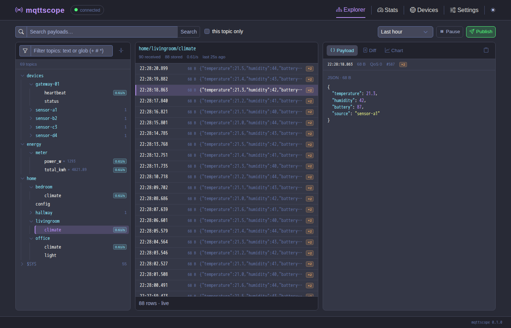

# mqttscope

A self-hosted web explorer for an MQTT broker: a live topic tree with counts, rates and the last
payload; a week of searchable message history (SQLite with FTS5); readable diffs between
consecutive payloads; charts of any numeric JSON field; device presence derived from status
topics; broker `$SYS` statistics; and publishing from the browser behind a toggle. Everything runs
in a single process over a single broker connection, every tunable is edited at runtime on the
Settings page, and everything the UI shows is also served as JSON and Server-Sent Events under
`/api/*`. Configuration, API, design and operations are documented in [`docs/`](docs/).



## Requirements

1. Docker with the Compose plugin (or Ruby 3.3 and Bundler to run it directly).
2. An MQTT broker reachable from the container. The broker user needs permission to subscribe
   to `#` and `$SYS/#`; publish permission is only needed for the Publish feature.
3. A local disk for the SQLite database (mounted at `./data` in the compose file).

## Setup

Prebuilt images are published to `ghcr.io/rojosinalma/mqttscope` (`latest`, `sha-<commit>`,
`<version>`; linux/amd64 and linux/arm64).

```sh
mkdir mqttscope && cd mqttscope
curl -fsSLO https://raw.githubusercontent.com/rojosinalma/mqttscope/main/.env.example
curl -fsSL https://raw.githubusercontent.com/rojosinalma/mqttscope/main/compose.example.yaml -o compose.yaml
cp .env.example .env
$EDITOR .env                 # set MQTT_HOST, MQTT_PORT, MQTT_USER, MQTT_PASS
docker compose up -d
```

To build from source instead, clone the repo and swap the `image:` line in `compose.yaml` for
`build: .`:

```sh
git clone https://github.com/rojosinalma/mqttscope.git
cd mqttscope
cp .env.example .env
cp compose.example.yaml compose.yaml
$EDITOR .env
docker compose up -d --build
```

Open http://localhost:9292. The `MQTT_*` variables seed the settings on the first boot; after
that, change them on the Settings page (see [`docs/configuration.md`](docs/configuration.md)).

## License

MIT — see [`LICENSE`](LICENSE).
